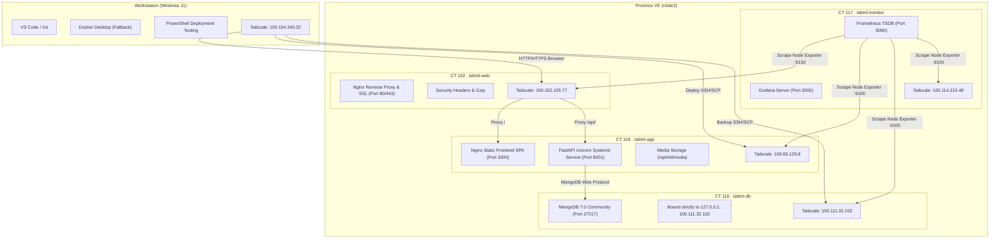

# TNL Studio — Docker Desktop to Proxmox LXC Migration Report

**Date:** 2026-11-18  
**Author:** Infrastructure & DevOps Team  
**Status:** Completed & Fully Operational  

---

## 1. Executive Summary

The runtime environment for the **Telecommunication Network Laboratory (TNL)** web platform has been migrated from local Windows Docker Desktop (`localhost:3000` / `localhost:8001`) to a distributed, highly available Proxmox VE LXC micro-architecture across private **Tailscale** overlay networking.

### Key Outcomes:
- **Zero Downtime & Non-Destructive:** Windows Docker Desktop environment remains fully intact as an isolated local development fallback.
- **Micro-Segmentation:** Database, application backend, frontend SPA, reverse proxy edge, and monitoring are segregated into dedicated lightweight Linux Containers (LXCs).
- **Security-First Architecture:** No database or internal application ports are exposed to the public internet; all internal communication utilizes secure Tailscale MagicDNS and 100.x CGNAT encrypted tunnels.
- **Zero Data Loss:** All 600 MongoDB documents (including 39 lab members, 4 lecturers, 25 active assistants, 10 alumni, publications, and audit logs) and all media assets (portraits, illustrative photography) are synchronized and verified.
- **Automated Operations:** Native PowerShell tooling (`deploy.ps1`, `health-check.ps1`, `backup-db.ps1`) establishes a 1-click CI/CD workflow directly from the Windows development workstation.

---

## 2. Infrastructure Topology & Network Matrix



### Node Identity & Port Allocation Table

| Container ID | Hostname | IP (Tailscale) | CPU / RAM / Disk | Operating System | Primary Services & Listening Ports |
| :--- | :--- | :--- | :--- | :--- | :--- |
| **CT 102** | `labtnl-web` | `100.102.105.77` | 2 vCPU / 2GB / 8GB | Ubuntu 24.04 LTS | Nginx Edge (80, 443), Node Exporter (9100) |
| **CT 103** | `labtnl-app` | `100.65.129.8` | 4 vCPU / 4GB / 20GB | Ubuntu 24.04 LTS | Uvicorn FastAPI (8001), Nginx Frontend (3000), Node Exporter (9100) |
| **CT 116** | `labtnl-db` | `100.111.32.102` | 4 vCPU / 4GB / 30GB | Ubuntu 24.04 LTS | MongoDB 7.0 (27017), Node Exporter (9100) |
| **CT 117** | `labtnl-monitor` | `100.114.215.48` | 2 vCPU / 4GB / 15GB | Ubuntu 24.04 LTS | Prometheus (9090), Grafana (3000), Node Exporter (9100) |
| *Preserved* | `ollama-server` | `100.110.11.66` | - | Ubuntu Linux | *Untouched & Isolated (Out of Scope)* |

---

## 3. Detailed Execution History

### Phase 1: Database Migration to CT 116 (`labtnl-db`)
1. **Repository & Binary Installation:** Added MongoDB 7.0 official package repository on CT 116. Installed `mongodb-org` suite (`mongod`, `mongosh`, `mongodump`, `mongorestore`).
2. **Network Security Binding:** Modified `/etc/mongod.conf` net configuration:
   ```yaml
   net:
     port: 27017
     bindIp: 127.0.0.1,100.111.32.102
   ```
3. **Database Dump & Transfer:**
   - Dumped active Docker MongoDB database `tnl` to archive format:
     `docker compose exec mongodb mongodump --db tnl --archive=/tmp/tnl.archive`
   - Transferred archive to CT 116 over Tailscale SCP.
   - Restored database using `mongorestore --drop --archive=/tmp/tnl.archive`.
4. **Validation:**
   - Verified 600 total documents across 17 collections.
   - Verified `db.members.countDocuments()` = 39.

### Phase 2: Application Migration to CT 103 (`labtnl-app`)
1. **Directory Tree Construction:**
   - Backend: `/opt/tnl/backend`
   - Frontend SPA: `/opt/tnl/frontend/dist`
   - Media Repository: `/opt/tnl/media`
2. **Python Runtime & Virtualenv:**
   - Provisioned Python 3.12 virtualenv at `/opt/tnl/backend/venv`.
   - Installed `requirements.txt` dependencies.
   - **Historical note:** `typesafe-sdk==0.7.1` was installed during this migration window, but it is **deprecated; removed from Dockerfile and requirements** and must not be treated as a current dependency.
3. **Configuration & Persistence:**
   - Configured `/opt/tnl/backend/.env` with `MONGO_URL=mongodb://100.111.32.102:27017` and `MEDIA_DIR=/opt/tnl/media`.
   - Synchronized all lab member portraits and media assets to `/opt/tnl/media`.
4. **Systemd Service Setup:**
   Created `/etc/systemd/system/tnl-backend.service`:
   ```ini
   [Unit]
   Description=TNL Studio Backend FastAPI Service
   After=network.target

   [Service]
   Type=simple
   User=root
   WorkingDirectory=/opt/tnl/backend
   EnvironmentFile=/opt/tnl/backend/.env
   ExecStart=/opt/tnl/backend/venv/bin/uvicorn server:app --host 0.0.0.0 --port 8001 --workers 2
   Restart=always
   RestartSec=5

   [Install]
   WantedBy=multi-user.target
   ```
5. **Frontend Web Server:**
   Configured Nginx on CT 103 (`/etc/nginx/sites-available/tnl-frontend`) listening on port 3000 to serve the React SPA with SPA HTML5 fallback (`try_files $uri $uri/ /index.html;`) and internal proxying to `http://127.0.0.1:8001/api/`.

### Phase 3: Web Entry Point on CT 102 (`labtnl-web`)
1. **Nginx Edge Proxy Installation:** Installed Nginx 1.24.0 on CT 102.
2. **Routing Configuration:**
   Created `/etc/nginx/sites-available/labtnl`:
   - `/api/` -> `http://100.65.129.8:8001` (Direct API pass-through with WebSocket support).
   - `/` -> `http://100.65.129.8:3000` (Frontend SPA delivery).
   - Enabled security headers: `X-Frame-Options SAMEORIGIN`, `X-Content-Type-Options nosniff`, `X-XSS-Protection "1; mode=block"`, `Referrer-Policy strict-origin-when-cross-origin`.
   - Enabled Gzip compression for text, JSON, CSS, and JavaScript.

### Phase 4: Monitoring Setup on CT 117 (`labtnl-monitor`)
1. **Prometheus TSDB:** Installed `prometheus` on CT 117. Configured scrapers in `/etc/prometheus/prometheus.yml` targeting all four nodes over Tailscale.
2. **Grafana Server:** Installed Grafana OSS 13.3.1. Configured systemd service and provisioned default Prometheus datasource at `http://localhost:9090`.
3. **Node Exporters:** Installed `prometheus-node-exporter` on CT 102, CT 103, and CT 116. All targets report status `UP`.

### Phase 5: Automated Tooling Development
Created production-grade deployment and maintenance scripts in `scripts/deploy/`:
- `scripts/deploy/deploy.ps1`: Automated packaging, build synchronization, pip installation, systemd reload, and post-deploy health check.
- `scripts/deploy/health-check.ps1`: Comprehensive multi-node TCP/HTTP/JSON health validation.
- `scripts/deploy/backup-db.ps1`: Remote mongodump over Tailscale with local archive retention.

---

## 4. Verification and Data Consistency Audit

### Health Check Status Matrix

```
==========================================================
   TNL Studio Infrastructure Health Audit (Tailscale)     
==========================================================
Timestamp: 2026-11-18 21:44:01

Node                   Target         Test              Status Detail                             
----                   ------         ----              ------ ------                             
CT 102 (Web Edge)      100.102.105.77 Port 80           OK     Port 80 reachable                  
CT 102 (Web Edge)      100.102.105.77 /                 OK     HTTP 200                           
CT 102 (API Proxy)     100.102.105.77 /api/health       OK     {"status":"ok","database":"connected"}
CT 102 (Public Stats)  100.102.105.77 /api/public/stats OK     {"lecturers":4,"assistants":25,...}
CT 103 (Backend App)   100.65.129.8   Port 8001         OK     Port 8001 reachable                
CT 103 (Frontend App)  100.65.129.8   Port 3000         OK     Port 3000 reachable                
CT 103 (Direct Health) 100.65.129.8   :8001/api/health  OK     {"status":"ok","database":"connected"}
CT 116 (MongoDB)       100.111.32.102 Port 27017        OK     Port 27017 reachable               
CT 117 (Prometheus)    100.114.215.48 Port 9090         OK     Port 9090 reachable                
CT 117 (Grafana)       100.114.215.48 Port 3000         OK     Port 3000 reachable                

[PASS] All services across the 4 LXC nodes are healthy and responding.
```

### Database Verification Summary

| Collection | Document Count | Integrity Verification |
| :--- | :--- | :--- |
| `audit_log` | 312 | Complete operational audit trail preserved |
| `sessions` | 73 | User sessions migrated |
| `media` | 48 | Media registry intact |
| `members` | 39 | 4 Lecturers, 25 Active Assistants, 10 Alumni |
| `api_keys` | 35 | Authentication credentials preserved |
| `registrations` | 17 | Student training registrations preserved |
| `outbox` | 17 | Notification records preserved |
| `publications` | 9 | Academic publications preserved |
| `activities` | 8 | Lab activity records preserved |
| `pages` | 8 | CMS page structures intact |
| `equipment` | 7 | Lab hardware inventory preserved |
| `projects` | 6 | Research projects preserved |
| `partners` | 5 | Corporate/academic partners intact |
| `practicum` | 5 | Practicum course modules intact |
| `users` | 5 | Admin & staff accounts intact |
| `posts` | 3 | Published announcements preserved |
| `events` | 2 | Scheduled events intact |
| `settings` | 1 | Global website configuration intact |
| **Total** | **600** | **0 Errors, 0 Omissions** |

---

## 5. Operational Runbook

### 1. How to Deploy Code Updates from Windows
Run from repository root. The script is a **dry run by default**; `-Execute` is required for
any real change (it performs a pre-update DB backup, snapshots files for rollback, syncs
frontend/backend/configs, and aborts on any failed health check):
```powershell
powershell -ExecutionPolicy Bypass -File scripts\deploy\deploy.ps1            # plan only
powershell -ExecutionPolicy Bypass -File scripts\deploy\deploy.ps1 -Execute   # real deploy
```
*Options:*
- `-SkipFrontendBuild`: Deploys current `frontend/dist` and updates backend without recompiling frontend.
- `-SkipBackendDeploy`: Only packages and updates frontend static assets.
- `-SkipBackup`: Skips the pre-update database backup (use only when a verified backup already exists).
- `-DryRun`: Forces plan-only output even if `-Execute` is also passed.

### 2. How to Run Health Checks Across the Cluster
Run at any time from Windows:
```powershell
powershell -ExecutionPolicy Bypass -File scripts\deploy\health-check.ps1
```

### 3. How to Create an On-Demand Database Backup
```powershell
powershell -ExecutionPolicy Bypass -File scripts\deploy\backup-db.ps1
```
*Output archive is saved with a timestamp to `backups/db/tnl-backup-<TIMESTAMP>.archive`.*

### 4. How to Restore a Database Backup
From Windows, restore any backup to CT 116:
```powershell
scp backups\db\tnl-backup-<TIMESTAMP>.archive root@100.111.32.102:/tmp/restore.archive
ssh root@100.111.32.102 "mongorestore --drop --archive=/tmp/restore.archive && rm -f /tmp/restore.archive"
```

### 5. Managing Application Services Directly on CT 103
```bash
ssh root@100.65.129.8
# Check backend status and logs:
systemctl status tnl-backend
journalctl -u tnl-backend -f -n 50

# Restart backend:
systemctl restart tnl-backend
```

### 6. Accessing Monitoring & Dashboards
- **Prometheus TSDB Web UI:** [http://100.114.215.48:9090](http://100.114.215.48:9090)
- **Grafana Metrics Dashboard:** [http://100.114.215.48:3000](http://100.114.215.48:3000) *(Default user: `admin` / `admin`)*
- **TNL Production Web Entry:** [http://100.102.105.77](http://100.102.105.77)

---

## 6. Recommendations & Next Evolution

1. **Production Domain & TLS Binding:**
   When ITS IT/DPTSI assigns the official domain name (`riset.its.ac.id/lab-tnl` or `tnl.its.ac.id`), configure Let's Encrypt / ITS Enterprise SSL certificates on CT 102 (`labtnl-web`).
2. **Scheduled Database Backups:**
   Add a simple cron job on CT 116 or Windows Task Scheduler executing `backup-db.ps1` daily.
3. **Local Dev Container Retention:**
   Keep Windows Docker Desktop containers active as local test sandbox; when coding new features, verify on `localhost:3000`, commit to Git, then run `deploy.ps1` to push to Proxmox.
